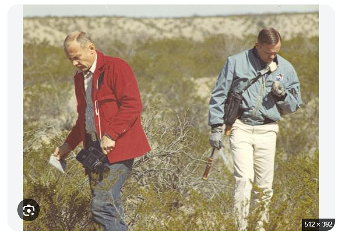

# Gancho inicial

*NASA · Entrenamiento geológico del Apollo 11 · Texas, 1969. Imagen proporcionada para este pitch.*

## Guion

Aquí vemos a Neil Armstrong y Buzz Aldrin practicando geología en Texas, en 1969, antes del Apollo 11.

Antes de despegar hacia la Luna, Neil había acumulado 959 horas de entrenamiento para el Apollo 11.

Hoy, prepararnos para vivir en otros mundos también exige elegir dónde ensayar aquí, en la Tierra. y no desperdiciar esas 959 horas de un astronauta depende de que tan eficaces seamos al hacerlo

## Fuentes y precisión del dato

- [NASA — Apollo Lunar Surface Journal: The First Lunar Landing](https://www.nasa.gov/wp-content/uploads/static/history/alsj/a11/a11.landing.html). Cita el resumen de entrenamiento del 15 de julio de 1969: Armstrong acumuló 959 horas, incluidas 285 en simuladores del módulo lunar. El total comprende distintas actividades de preparación; no equivale a 959 horas de prácticas geológicas ni de entrenamiento en bases análogas.
- [NASA — Apollo 11 Preparations, February 1969](https://www.nasa.gov/history/50-years-ago-apollo-11-preparations-february-1969/). Describe la salida de entrenamiento geológico del 24 de febrero de 1969 cerca de Sierra Blanca y Fort Quitman, Texas, donde practicaron la selección de muestras de rocas.
- [NASA — Apollo 11 Image Library](https://www.nasa.gov/wp-content/uploads/static/history/alsj/a11/images11.html). Archivo de fotografías del entrenamiento previo a la misión.
