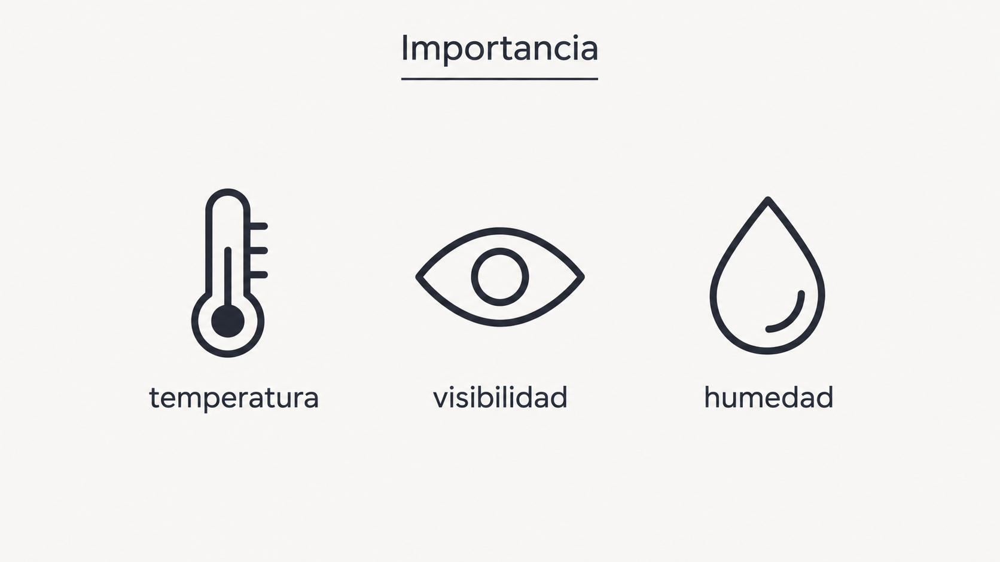

# Gancho inicial

*NASA · Entrenamiento geológico del Apollo 11 · Texas, 1969. Imagen proporcionada para este pitch.*

## Guion

Aquí vemos a Neil Armstrong y Buzz Aldrin practicando geología en Texas, en 1969, antes del Apollo 11.

Antes de despegar hacia la Luna, Neil había acumulado 959 horas de entrenamiento, para una misión de tan solo 2 días.

Hoy, las misiones continuan; el regreso a la Luna en 2028, los futuros amartizajes y nuevas fronteras por explorar. Sin embargo las bases análogas aún son excasas. Los desafios que implican las misiones y la dificultad de encontrar lugares en la tierra vuelve una necesidad que aún debemos resolver. 

---

**Guion:** Una base análoga en Islandia, en un tubo de lava reveló que el rover no podía entrar ni salir solo: la pendiente y las rocas bloqueaban el acceso. Mejor descubrirlo en la Tierra que en la Luna.

Slide problema: Hoy no existe una herramienta que compare datos y evalúe dónde es viable instalar una base análoga​.

Slide solución: La solución es Coypus Analog Mission Database: una interfaz que permite buscar y comparar lugares para instalar bases análogas según las necesidades de cada misión. El usuario define parámetros físicos, geológicos y logísticos, y la plataforma muestra en el mapa los sitios que coinciden. Para compararlos, integra datos oficiales de la Tierra, la Luna y Marte e identifica similitudes relevantes para cada misión. Para cada lugar, reúne las fuentes disponibles y señala qué datos siguen pendientes. Así, ayuda a evaluar y comparar la viabilidad de cada candidato con criterios claros y evidencia visible.

**Guion:** Ahora, ¿Qué hace que un lugar de la Tierra sea útil para preparar una misión? La interfaz reune condiciones de la Luna y Marte que las misiones necesitan representar, como temperatura, presión y humedad; la exposición a la radiación; y la presencia de agua superficial o hielo en zonas glaciares.

Hilo al slide siguiente: Entonces ¿Con qué comparamos estos datos? Con información de la Nasa Power, que como se observa a mi espalda, se obtienen gráficos de temperatura, humedad, presión y radiación sobre la tierra.

Ahora echemos un vistazo más de cerca a nuestra apliación: Immaginemos que queremos encontrar....

---

## Fuentes y precisión del dato

- [NASA — Apollo Lunar Surface Journal: The First Lunar Landing](https://www.nasa.gov/wp-content/uploads/static/history/alsj/a11/a11.landing.html). Cita el resumen de entrenamiento del 15 de julio de 1969: Armstrong acumuló 959 horas, incluidas 285 en simuladores del módulo lunar. El total comprende distintas actividades de preparación; no equivale a 959 horas de prácticas geológicas ni de entrenamiento en bases análogas.
- [NASA — Apollo 11 Preparations, February 1969](https://www.nasa.gov/history/50-years-ago-apollo-11-preparations-february-1969/). Describe la salida de entrenamiento geológico del 24 de febrero de 1969 cerca de Sierra Blanca y Fort Quitman, Texas, donde practicaron la selección de muestras de rocas.
- [NASA — Apollo 11 Image Library](https://www.nasa.gov/wp-content/uploads/static/history/alsj/a11/images11.html). Archivo de fotografías del entrenamiento previo a la misión.
